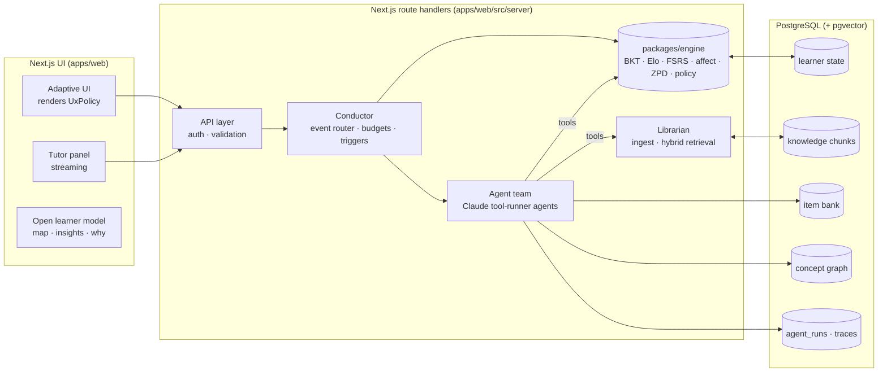
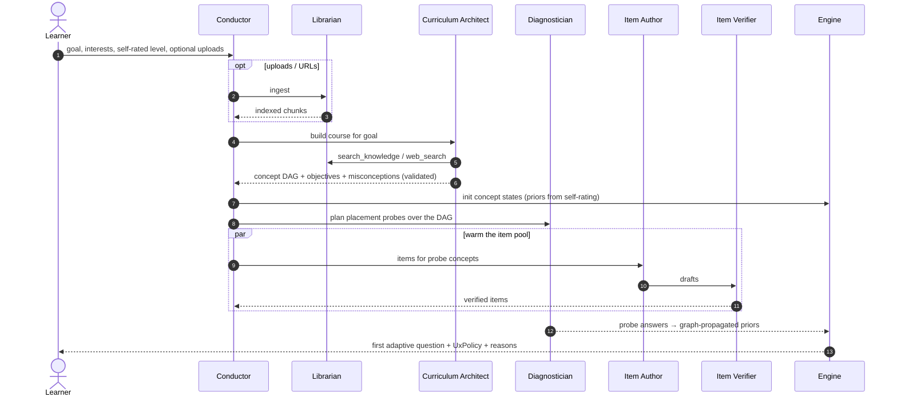
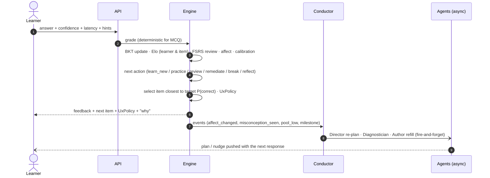
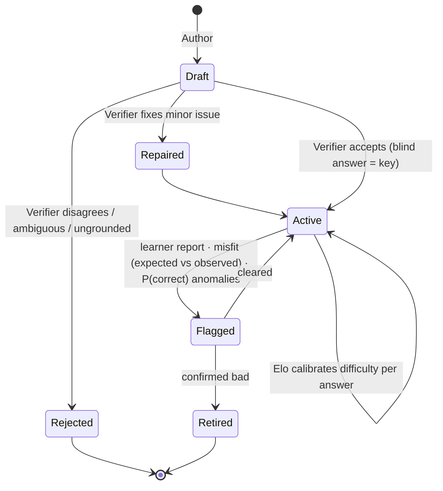
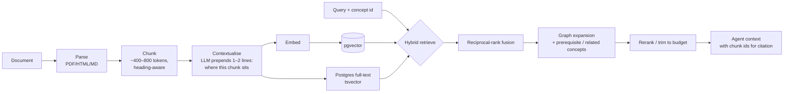

# Architecture — Agentic Adaptive Learning Platform (v2)

> Status: design baseline for the v2 rebuild. The v1 codebase (NestJS + Neo4j + Groq) is preserved at git tag `legacy-v1`.
> Companion docs: [EVALS.md](EVALS.md) (how we measure it) · [RESEARCH.md](RESEARCH.md) (comparative study and sources).

## 1. Design principles

1. **The learner model is deterministic; agents are advisors and authors.** Knowledge tracing models beat LLMs at predicting what a learner knows. They are also sub-second and orders of magnitude cheaper ([RESEARCH.md §2](RESEARCH.md#2-learner-modelling)). So a pure TypeScript engine (`packages/engine`) owns the state. LLM agents read it through tools and change it only through narrow, validated actions.
2. **One centralized, versioned learner state.** Every agent reads the same snapshot, so agents cannot drift or contradict each other (the IntelliCode pattern).
3. **Agents are event-driven, not always-on.** A code-level *Conductor* routes events to agents. Most learner interactions never call an LLM, because the engine picks the next question in milliseconds. Agents run when judgement or language is needed: building curricula, writing items, diagnosing misconceptions, tutoring, re-planning, reflecting.
4. **Nothing an LLM generates reaches a learner unverified.** Items go Author → Verifier → bank. Real answers then calibrate their difficulty online (Elo), and items that don't fit get retired.
5. **Open learner model.** Every adaptive decision carries plain-language reasons ("why this question?", "why recovery mode?") that the UI shows to the learner.
6. **Grounded by default.** Content is generated against retrieved sources (RAG over the curriculum, uploaded material and the web), and carries citations the Verifier checks.

## 2. System overview



**One deployable app.** Next.js route handlers host the API and the agents, and the engine is a workspace package. Postgres holds everything: graph, state, items, vectors and traces. That replaces the four stores in v1 (Postgres, Neo4j, Redis and a Python service). Background work (item pool refill, nightly digests) runs as an async job queue, a Postgres `jobs` table with a worker loop, so it can later move to a separate worker process or to Claude Managed Agents without code changes in callers.

## 3. The agent team

| # | Agent | Responsibility | Trigger | Reads (tools) | Writes (validated actions) | Output |
|---|-------|---------------|---------|---------------|-----------------------------|--------|
| 1 | **Learning Director** (orchestrator) | Plans the session and re-plans when the learner's state shifts | session start · affect change · 3 wrong in a row · mastery milestone | `get_learner_snapshot`, `get_frontier`, `get_due_reviews`, `get_learner_memory` | `set_session_plan`, `set_ux_override` (bounded, expires), `request_items` | Session plan + coach message + reasons |
| 2 | **Curriculum Architect** | Turns a goal ("crack system-design interviews in 6 weeks") into a concept DAG with objectives and known misconceptions | new goal / course creation · uploaded material | `search_knowledge` (RAG), `web_search` (server tool) | `create_course_graph` (DAG validated: acyclic, bounded size) | Course graph with citations |
| 3 | **Diagnostician** | Placement testing, misconception diagnosis, grading open responses | enrolment · wrong answer on open response · repeated misconception | `get_item_with_key`, `get_concept_misconceptions`, `get_attempt_history` | `record_misconception`, `grade_response` | Diagnosis + feedback |
| 4 | **Item Author** | Writes items for a (concept, target difficulty, format, misconception) slot. Each distractor encodes a known misconception. Contexts are personalised to the learner's interests | pool for a slot falls below threshold | `search_knowledge`, `get_concept`, `get_existing_items` (dedup) | `submit_item_draft` | Draft items with source citations |
| 5 | **Item Verifier** | Blind-solves each draft *without the key*, then audits it for correctness, ambiguity, single best answer, grounding in the cited source, difficulty estimate and bias | every draft | `get_draft` (key hidden on first pass), `get_sources` | `accept_item` / `reject_item` / `repair_item` | Verified item + verifier notes |
| 6 | **Tutor** | Socratic help on the current item. Holds the answer key but never volunteers it; climbs a hint ladder; adapts tone to the UX policy | learner opens the tutor · proactive nudge from policy | `get_current_item` (with key), `get_learner_snapshot`, `search_knowledge` | `log_hint_level`, `record_misconception` | Streamed dialogue |
| 7 | **Coach** | Metacognition and motivation: session reflection, confidence-calibration feedback, goal setting, weekly digest; maintains long-term learner memory | session end · nightly | `get_session_summary`, `get_calibration`, `get_learner_memory` | `write_learner_memory`, `set_goal` | Reflection card / digest |
| 8 | **Librarian** (RAG) | Ingests sources (uploads, URLs, curriculum text): chunk → add context to each chunk → embed → index; serves hybrid retrieval to other agents | upload · course creation | — | `index_document` | Chunks + embeddings |

The **Conductor** is plain TypeScript, not an LLM. It owns routing, per-learner token budgets, concurrency limits, retries and timeouts, and the guard that no agent may block a learner's next question.

### 3.1 Why these boundaries

- **Author and Verifier are separate agents with different context.** A generator grading its own work shares its blind spots. Blind solving is the cheapest strong check: if the Verifier's answer disagrees with the key, the item is wrong or ambiguous.
- **Director is the only agent that changes the plan, and its overrides are bounded.** It can, for example, push the success target ±0.1 for 10 minutes. The engine's guardrails still apply, so a bad LLM decision degrades gracefully instead of derailing the learner.
- **Tutor holds the answer key but is instructed not to leak it.** The Harvard physics AI-tutor RCT gave the tutor full solutions to prevent hallucinated physics, then constrained it pedagogically. We do the same and measure leakage ([EVALS.md §4](EVALS.md#4-tutor)).

## 4. Agent flow

### 4.1 Onboarding: goal to first question



**Graph-aware placement.** A correct answer on a deep concept raises the priors of its prerequisites; a wrong answer on a shallow concept lowers its dependents'. The Diagnostician picks probes roughly by binary search over the topological order, so 6–10 questions place a learner on a 30-concept graph.

### 4.2 The practice loop (hot path: no LLM on the critical path)



Open-response items are the one exception: grading them needs the Diagnostician, a single low-effort call. While it runs the UI shows "checking your reasoning…".

### 4.3 Item lifecycle



### 4.4 Adaptive UX

The engine emits a `UxPolicy` with every response, and the UI is a pure function of it:

| Learner state (engine) | Mode | What changes in the UI |
|---|---|---|
| frustrated (streak of errors, low accuracy, hint spiral) | `recovery` | easier target (≈0.85), hints offered proactively, minimal layout, encouraging tone, tutor nudge, break suggested after more errors |
| bored (fast, certain, correct) | `challenge` | harder target (≈0.6), timer shown, hints only after an attempt, terse feedback, harder formats |
| confused (slow and unsure) | `focus` | detailed explanations, worked example offered, confidence prompt kept |
| due reviews dominate | `review` | retrieval-first cards, interleaved concepts, brief feedback |
| new concept unlocked | `explore` | micro-lesson first, then scaffolded items |
| disengaged (rapid guessing) | `recovery` | slow-down prompt, confidence required, Coach check-in |

The Director may override the mode (bounded and time-limited) and must record a reason, which the UI shows.

### 4.5 The agentic loop: events, re-planning and reflection

Every agent is woken by an event; none runs on a timer or on the learner's critical path. This table is the complete routing in `server/conductor/index.ts`:

| Event (emitted by) | Job → agent | Dedupe slot · cooldown | What changes for the learner |
|---|---|---|---|
| `course_requested` (course builder) | `build_course` → Librarian → Curriculum Architect → Item Author/Verifier | per course | A new course opens with lessons and first questions |
| `pool_low` (item selection) | `author_items` → Item Author → Item Verifier | per concept · 15 min | Fresh verified questions near the learner's level |
| `misconception_repeat` (engine) | `author_items` (targeted) + `remember` → Diagnostician | per concept+misconception · 15/60 min | Questions aimed at the mix-up; a diagnosis in learner memory |
| `session_started` (start session) | `director_replan` → Learning Director | per session+trigger · 2 min | An opening plan, if one helps |
| `struggling` (engine: error streak, lapse) | `director_replan` → Learning Director | per session+trigger · 2 min | An easier, re-focused plan |
| `affect_changed` (UX mode shift) | `director_replan` → Learning Director | per session+trigger · 2 min | Plan adjusted to the new state |
| `mastered` (engine) | `director_replan` → Learning Director | per session+trigger · 2 min | Brief celebration and what it unlocks |
| `session_ended` (end session) | `coach_reflect` → Coach | per session | Reflection card; a memory note for other agents |
| learner opens the tutor | Tutor (streamed, synchronous) | n/a | Socratic help on the current item |
| short-answer submitted | Diagnostician grading (synchronous, low effort) | n/a | Free-text answer graded |

```mermaid
sequenceDiagram
  autonumber
  actor L as Learner
  participant API
  participant E as Engine
  participant C as Conductor
  participant D as Learning Director
  participant V as Plan rules
  participant Co as Coach
  participant M as Learner memory

  L->>API: answer (3rd wrong in a row)
  API->>E: applyAttempt → event "struggling"
  E-->>L: feedback + next item (no waiting on agents)
  API-)C: emit(struggling)
  C->>D: director_replan (snapshot: concepts, affect, engine's own pick, memory)
  D->>V: set_session_plan(draft)
  V-->>D: "Not accepted: learner is frustrated; no harder questions"
  D->>V: set_session_plan(fixed draft)
  V-->>D: accepted → sessions.plan (focus · ±0.1 target · mode · expiry)
  L->>API: next
  API->>E: chooseNextAction + deriveUxPolicy with the plan as a bounded override
  E-->>L: item + UxPolicy + plan headline and reason
  L->>API: end session
  API-)C: emit(session_ended)
  C->>Co: coach_reflect (per-concept change, mistakes, hints, calibration)
  Co->>M: memory note (only for durable patterns)
  Co-->>L: reflection card (session end screen + dashboard)
  M--)D: read at the next re-plan (and by Tutor, Author)
```

**Three layers of guardrails on the Director.** A Director plan is advice. It is checked three times before it reaches the learner:

1. **Plan rules** (`agents/director/rules.ts`, unit-tested) reject a draft that is out of bounds: a target shift beyond ±0.1, a duration outside 3–20 minutes, an unknown or locked focus concept, ids in learner-facing text, or harder work (negative shift, `challenge`) for a frustrated or disengaged learner. Errors go back to the agent to fix.
2. **The engine re-clamps on every step**, so a plan that was safe when written can't hurt the learner later. `targetSuccess` clamps the override and ignores a negative shift while the learner is struggling; `deriveUxPolicy` ignores a `challenge` override in the same state; `chooseNextAction` only boosts a focus concept that is already a valid candidate; and every plan expires.
3. **The Conductor keys cooldowns per session and trigger.** An opening plan can't suppress a later `struggling` re-plan. This was found in an end-to-end run where a stale "challenge" plan outlived a run of 8 wrong answers.

The Director can also call `keep_current_plan` (no churn when the engine is already right) and `request_items` (at most 2 per run; routed back through the Conductor to the Author).

## 5. RAG design

### 5.1 Sources

1. **Curriculum knowledge:** concept summaries, objectives and misconception catalogues produced by the Architect (always indexed).
2. **Learner and teacher material:** PDFs, notes and URLs uploaded per course.
3. **Web:** Claude's server-side `web_search` / `web_fetch` tools. Used only by the Architect, and optionally by the Author for current topics. Results come back with citations.
4. **Learner memory:** episodic notes the Coach writes ("confuses BFS and DFS queue/stack", "prefers cricket examples"). These are retrieved by the Tutor and Author for personalisation.

### 5.2 Pipeline



- **Contextual retrieval:** each chunk gets a short situating preamble before it is embedded and keyword-indexed. This is Anthropic's published technique for reducing retrieval failures.
- **Hybrid search:** vector similarity plus Postgres full-text, merged with reciprocal-rank fusion. Keyword search catches exact terms (API names, Big-O notation) that embeddings blur.
- **Graph expansion (GraphRAG-lite):** retrieval is scoped to the target concept, then widened along prerequisite and related edges in the concept graph. The graph lives in Postgres and is traversed with recursive CTEs; no separate graph DB is needed.
- **Embeddings are pluggable:** a provider interface with Voyage AI (Anthropic's recommended embeddings partner) as the default. A local model is the zero-key option, and a full-text-only fallback means the app still works with no embedding provider at all.
- **Grounding contract:** Author and Tutor outputs cite chunk ids. The Verifier checks every factual claim in an item against the cited chunks, and an ungrounded claim means rejection.

## 6. Learner model (packages/engine)

| Component | Model | Why |
|---|---|---|
| Knowledge | Bayesian Knowledge Tracing per concept; guess follows the format (1/options); hints weaken correct evidence; graph propagation to prerequisites/dependents | Interpretable, cold-start friendly, proven |
| Ability & item difficulty | Elo / 1PL-IRT with uncertainty-decaying K, guess-corrected | Calibrates LLM-written items from real answers; drives ZPD item choice |
| Memory | FSRS-6 (`ts-fsrs`); grade from correctness × confidence × hints × speed | State-of-the-art spaced repetition |
| Affect | Sensor-free log detectors: frustrated / bored / confused / disengaged / flow | Drives UX mode and ZPD target |
| ZPD controller | Target P(correct) ≈ 0.72, moved by affect and the recent success rate (Pelánek-style correction) | Practice ≠ testing; learners prefer and benefit from ~65–75% |
| Metacognition | Confidence calibration (Brier score, over/under-confidence) | Coach feedback; FSRS grading |
| Policy | Next-best-action scoring across due reviews, frontier concepts, remediation and new learning, with an interleaving constraint; every choice comes with reasons | Transparent and testable |

Mastery shown to the learner = P(known) × current retrievability, so mastery decays visibly when a concept goes unreviewed.

## 7. Agent runtime

- **SDK:** `@anthropic-ai/sdk`, using the beta Tool Runner (`client.beta.messages.toolRunner`) with Zod-typed tools. Structured outputs (`messages.parse` with Zod) are used for single-shot generators such as Author, Verifier and Architect output.
- **Model:** `claude-opus-5-5` for every agent (configurable per agent via env). Effort is set per agent: `low` for Verifier pass 1, grading and Tutor turns; `medium` for Author, Director and Coach; `high` for Architect.
- **Refusal fallback:** server-side `fallbacks: "default"` (beta `server-side-fallback-2026-07-01`), and `stop_reason` is checked before reading content.
- **Prompt caching:** frozen system prompts and a deterministic tool order give a cacheable prefix. Volatile learner state goes in the last user turn or a mid-conversation system message.
- **Why not Managed Agents for the hot path:** these agents are short, latency-sensitive and need in-process database tools, with no sandbox. Managed Agents is the planned home for long background jobs, such as building a course from a 300-page PDF or running nightly cohort analytics ([RESEARCH.md §4](RESEARCH.md#4-agent-runtime)).
- **Layers:** `agents/llm.ts` holds the Claude client and the three call shapes (structured output, tool loop, streaming tool loop) with no database access; `agents/runtime.ts` adds tracing and budgets on top. Agent cores that take plain data (e.g. the Director's `decidePlan` in `director/decide.ts`) can therefore run in the eval harness without Postgres.
- **Observability:** every run writes an `agent_runs` row: agent, input digest, tool calls, output, tokens, cost, latency, status, and a trace id. A per-learner activity feed shows learners what the agents did for them.
- **Safety and cost guards:**
  - per-learner daily token budget
  - per-agent max iterations
  - timeouts
  - tool inputs validated with Zod before execution
  - agents can only call write-actions that the engine re-validates

## 8. Data model (PostgreSQL)

| Table | Purpose |
|---|---|
| `users`, `learner_profiles` | identity, goals, interests, preferences, long-term agent memory (JSON) |
| `courses`, `concepts`, `concept_edges` | concept graph (prerequisite / related), objectives, misconception catalogue |
| `enrollments`, `concept_states` | per-learner state: P(known), ability, FSRS card, streaks, misconception counts |
| `items` | item bank: stem, options with misconception tags and feedback, key, hints ladder, Elo difficulty, provenance, citations, verifier notes, status |
| `attempts` | every answer: response, correctness, confidence, latency, hints, misconception, state before/after |
| `sessions` | plan, UX policy history, summary |
| `documents`, `chunks` | RAG sources, contextualised chunks, `tsvector`, `vector` |
| `tutor_messages` | tutor dialogue per item |
| `agent_runs`, `jobs` | traces and async job queue |

## 9. Repository layout (target)

```
apps/web/                 Next.js 16 app (UI + route handlers)
  src/app/                pages: onboarding, learn, session, map, insights
  src/server/agents/      one file per agent + shared runtime (runner, budgets, tracing)
  src/server/conductor/   event router, triggers, jobs
  src/server/rag/         ingest, chunk, embed, retrieve
  src/server/db/          Drizzle schema + queries
packages/engine/          deterministic learner model (+ vitest)
evals/                    datasets, simulators, judges, runners (see EVALS.md)
docs/                     this file, EVALS.md, RESEARCH.md
```

## 10. Build order

1. Engine (pure TS + tests): BKT, Elo, FSRS, affect, ZPD, policy, UX
2. Database schema + seed course (works with no API key)
3. Practice loop end-to-end (deterministic, no agents)
4. Agent runtime (runner, tracing, budgets) + Item Author/Verifier
5. Tutor (streaming) + Diagnostician
6. Curriculum Architect + Librarian (RAG)
7. Director + Coach (§4.5) + adaptive UX polish + open learner model
8. Eval harness (simulated learners, item-quality, tutor judges) + CI
